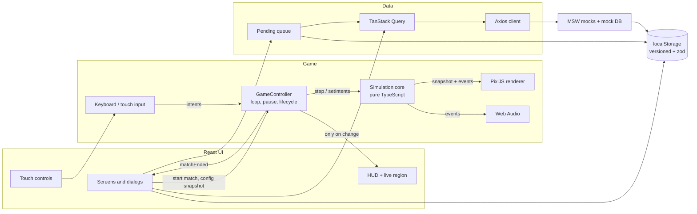

# Architecture

This document describes how Pirate Battle is organised and why: the React/PixiJS
integration, the simulation cycle, collisions, resource management, local
persistence and the ranking/history integration (contracts, cache and recovery of
pending registrations), plus balancing decisions and known limitations.

## Layers



| Layer         | Folder                       | Responsibility                                                                                        | May depend on                                                   |
| ------------- | ---------------------------- | ----------------------------------------------------------------------------------------------------- | --------------------------------------------------------------- |
| Rules         | `src/game/core`              | Deterministic simulation: movement, AI, weapons, projectiles, collisions, damage, spawns, match rules | `config` only (**no PixiJS, React or DOM**, enforced by ESLint) |
| Configuration | `src/game/config`            | `GameConfig`, defaults, validation, immutable snapshots, test presets                                 | —                                                               |
| Rendering     | `src/game/render`            | PixiJS scene built from the simulation snapshot and events                                            | core (read-only), PixiJS                                        |
| Input         | `src/game/input`             | Keyboard and touch → boolean intents                                                                  | core types                                                      |
| Glue          | `src/game/GameController.ts` | Pixi `Application`, fixed-step loop, pause, resize, HUD bridge, teardown                              | everything in `game`                                            |
| UI state      | `src/app`, `src/ui`          | Screens, dialogs, HUD, forms (React)                                                                  | game controller API, data, persistence                          |
| Data          | `src/data`                   | Contracts, HTTP, queries, registration, pending queue                                                 | —                                                               |
| Mocks         | `src/mocks`                  | MSW handlers, mock database, fixtures, scenarios                                                      | data contracts                                                  |

The core never reads time (`Date.now`, `performance.now`) or randomness
(`Math.random`), and never touches the DOM: ESLint rules forbid those imports and
globals in `src/game/core`.

## React ↔ PixiJS integration

- **No router**: a small Zustand screen machine (`menu → loading → playing → result`,
  plus `options` and `log`). A reload always lands on the menu, which ends any match
  in progress (an abandoned match is never recorded).
- **`GameCanvas`** owns the Pixi canvas. `GameController.create()` is asynchronous
  (WebGL initialisation), so the effect keeps a `disposed` flag: under React
  StrictMode the first mount is disposed before the promise resolves and the late
  instance is destroyed immediately. Exactly one canvas exists per match (verified
  by E2E: menu ↔ game cycles leave zero canvases behind).
- **`session.key`** changes on every new match: _Play again_ remounts the game
  screen and creates a brand-new controller and simulation.
- **React never renders per frame.** The controller publishes a small HUD state
  (hp, max hp, score, whole remaining seconds, phase, result) into a vanilla Zustand
  store and only when a displayed value changes. The HUD subscribes with narrow
  selectors; the live region receives discrete events only (start, pause, resume,
  low health, 10 s left, end).
- **PixiJS draws** the arena, ships, projectiles, effects and the health bars above
  every ship; **React draws** menus, forms, panels, dialogs, the HUD and the touch
  controls (semantic, focusable, accessible).
- The game (PixiJS included) is **code-split**: it is fetched by the loading screen
  together with the textures.

## Simulation cycle

- **Fixed step:** `Simulation.step()` advances exactly `1/60 s`. The controller's
  `FixedStepClock` accumulates real frame time (clamped to 100 ms, so a hitch or a
  hidden tab never causes a burst of catch-up steps) and runs the number of steps
  due; the leftover fraction (`alpha`) interpolates positions and headings when
  rendering. Movement, damage, cooldowns and spawns are therefore independent of the
  frame rate.
- **Order of systems per step:** input → enemy AI → movement (+ static collisions)
  → ship collisions (Chaser ramming, separation) → weapons → projectiles (swept
  hits) → damage and score → removal of destroyed entities → spawner → match rules.
- **Events** (`shotFired`, `projectileHit`, `shipDamaged`, `enemyDestroyed`,
  `matchEnded`, …) are queued during the step and dispatched after it, so listeners
  (renderer, audio, UI) always see a consistent state and never mutate it.
- **Determinism:** randomness comes from a seeded `mulberry32` RNG; same seed + same
  inputs ⇒ same match (verified by unit tests and `npm run sim:smoke`).
- **Match end:** when time runs out (active time only, pauses excluded) or the
  player is destroyed, the phase becomes `ended`, `matchEnded` is emitted once and
  `step()` becomes a no-op: movement, attacks, damage, spawns and scoring stop.
- **Pause:** pausing simply stops stepping. On pause and on resume the accumulator,
  keyboard and touch state and simulation intents are cleared, so neither time nor
  held controls carry over. Automatic pause on `visibilitychange` (hidden), window
  `blur` and portrait orientation on touch devices; resuming always needs an action.
- **Test clock:** with `?e2e=1` the ticker only renders; the simulation advances
  exclusively through `window.__PB__.advance(ms)`, which runs the same real steps.

### Entities and rules

- **Player:** forward-only movement with acceleration/deceleration, turning both
  ways, front cannon (1 shot) and two broadsides (3 parallel shots spread along the
  hull, perpendicular to the heading, independent cooldowns). Holding a fire control
  fires whenever the weapon is ready.
- **Chaser:** steers straight at the player when a corridor as wide as its hull is
  clear, otherwise follows a flow field around islands. On contact it deals damage
  once and explodes — destroyed by itself, so it never awards points.
- **Shooter:** same navigation until the player is within attack range with line of
  sight; then it stops at the preferred distance, turns its bow to the player and
  fires when aligned and its cooldown allows.
- **Spawner:** one enemy every `spawn.intervalSec` of active time (first after
  `initialDelaySec`) while fewer than `maxAlive` are alive. The first two spawns are a
  Chaser and a Shooter (both types always appear), then weighted random. Candidate
  points are precomputed tile centres free of obstacles (`clearanceRadius`), filtered
  each cycle by distance to the player (`minDistanceFromPlayer`), the cone in front
  of the player, the arena margins and other ships; a seeded jitter avoids a grid
  look. New enemies have a short grace period (no firing, no contact damage).
- **Score:** +1 per enemy destroyed by the player's projectiles while the match is
  running; damage applied to an already destroyed ship is discarded.
- **Destroyed enemies** are removed in the same step: they no longer move, collide,
  fire or receive hits, and their projectiles still in flight are removed too.

## Collisions

- **Map:** 20 × 12 tiles of 64 px (1280 × 768 world). Two ASCII layers (ground and
  objects) are validated and turned into tiles and static colliders: island
  rectangles (boxes inset to the shoreline) and rocks (circles). Fort pieces and
  plants are decoration on islands.
- **CollisionGrid:** spatial index storing the colliders overlapping each cell;
  queries only test nearby colliders and are allocation-free. The arena edges are
  solid.
- **Ships** are two circles (bow and stern). After moving, both circles are pushed
  out of obstacles and back inside the arena, iteratively, so ships slide along
  shores and edges instead of stopping dead. Ship–ship overlaps are separated
  symmetrically.
- **Projectiles** use a **swept test**: the segment from the previous to the next
  position is tested against the opposing ships (circles enlarged by the projectile
  radius) and the static colliders; the earliest hit wins. A projectile is consumed
  by its first hit, so damage is applied exactly once; it is also removed when it
  reaches its range or lifetime, or leaves the arena. Islands and rocks block shots.
- **Navigation:** a Dijkstra flow field over the tile grid (8-neighbour, no corner
  cutting) towards the player, rebuilt 4 × per second only when the player changes
  cell.

## Rendering

- **Viewport:** the world keeps its aspect ratio (uniform scale, letterbox). The
  area outside the arena is darkened water with an outline, so the limits are always
  visible. A `ResizeObserver` on the host element resizes the renderer; resizing
  never changes the rules. Device pixel ratio is honoured (capped at 2) with
  `autoDensity`.
- **Layers:** water (tiling sprite filling the canvas) → cached tilemap → ships →
  projectiles and trails → effects → health bars.
- **Ships** switch between four sprites (intact → damaged → heavily damaged → sunk)
  according to `visuals.damageStages`, show flames when badly damaged and flash red
  when hit. Health bars use the atlas frame + fill, clipped using the atlas
  `fill_rect` metadata (logical 1× units even in the retina atlas).
- **Feedback:** muzzle flash, projectile trails, water splash, wood debris on hits,
  3-frame explosion and sinking hull, screen shake when the player is hit (skipped
  with `prefers-reduced-motion`), plus sounds.

## Resource management

- **Textures** are loaded once (`loadGameAssets`, with progress) and shared by every
  match: the ship/effects atlas (converted from the Starling XML), the UI atlas
  (retina variant on HiDPI screens) and the tilesheet. A failed load rejects with an
  accessible error and a retry (PixiJS drops failed promises from its cache);
  textures are decoded on the main thread and a load timeout guarantees the screen
  never hangs. Combat only starts once everything is ready.
- **Pools:** projectile objects (simulation) and their sprites, effect sprites and
  health-bar fill textures are recycled.
- **Teardown** (`GameController.destroy()`, idempotent): removes the ticker
  callback, keyboard/blur listeners and the `ResizeObserver`, unsubscribes from
  simulation events, destroys views, pools, the cached tilemap and the Pixi
  application (`removeView`, children, graphics contexts) — without destroying the
  shared textures — and stops the game's audio loops. See
  [docs/PROFILING.md](docs/PROFILING.md) for the memory measurements over repeated
  cycles.

## Local persistence

All keys are versioned and validated with zod on read; missing or corrupted values
fall back to defaults instead of crashing. Storage errors (private mode, quota) are
ignored.

| Key                | Content                                                                                                                      |
| ------------------ | ---------------------------------------------------------------------------------------------------------------------------- |
| `pb.options.v1`    | Game session time and enemy spawn time                                                                                       |
| `pb.lastResult.v1` | Last completed match (score, duration, reason, settings, match id, registered flag) — reopened from the menu after a refresh |
| `pb.player.v1`     | Local player id (UUID) and generated captain name                                                                            |
| `pb.pending.v1`    | Registrations not yet confirmed by the server                                                                                |
| `pb.audio.v1`      | Mute preference                                                                                                              |
| `pb.mockdb.v1`     | Mock server database (confirmed registrations + fixtures)                                                                    |
| `pb.mock.scenario` | Selected network scenario                                                                                                    |

## Ranking and match history

### Contracts

Defined once with zod in `src/data/contracts.ts` and shared by the client and the
MSW handlers:

```ts
type EndReason = 'time_up' | 'defeated';
interface MatchRecord {
  matchId: string; // created when the match ends; idempotency key
  playerId: string;
  playerName: string;
  playedAt: string; // ISO date of the end of the match
  score: number;
  durationMs: number; // effective active time, pauses excluded
  endReason: EndReason;
  settings: { sessionTimeSec: number; spawnIntervalSec: number };
}
interface Page<T> {
  items: T[];
  page: number;
  pageSize: number;
  totalItems: number;
  totalPages: number;
  revision: number;
}
type RankingEntry = MatchRecord & { rank: number };
```

| Method | Route                                                        | Response                                                        |
| ------ | ------------------------------------------------------------ | --------------------------------------------------------------- |
| `GET`  | `/api/ranking?sessionTimeSec&spawnIntervalSec&page&pageSize` | `Page<RankingEntry>`                                            |
| `GET`  | `/api/players/:playerId/matches?page&pageSize`               | `Page<MatchRecord>`, most recent first                          |
| `POST` | `/api/matches` (header `Idempotency-Key: <matchId>`)         | `201 {record, created: true}` or `200 {record, created: false}` |

- **The ranking compares only matches with the same configuration** (session time
  and spawn interval); the tab defaults to the current options and offers filters.
  One entry per match.
- **Deterministic tie-break:** score desc → duration desc (longer survival first) →
  date asc (earliest achievement first) → match id asc.
- Every response is validated; a malformed payload becomes a handled "contract"
  error.

### Client: Axios + TanStack Query

- **Axios** (`baseURL /api`, 4 s timeout) normalises every failure into an
  `ApiError` (`timeout`, `network`, `http`, `contract`, `canceled`) used for
  messages and retry decisions. TanStack's abort signal is forwarded on every call.
- **Query keys:** `['ranking', sessionTimeSec, spawnIntervalSec, page]` and
  `['history', playerId, page]`; the prefixes `['ranking']` / `['history']` are
  invalidated together.
- **Cache:** `staleTime` 15 s, refetch on window focus, `refetchOnMount: 'always'`
  so a tab refreshes every time it is shown, `placeholderData: keepPreviousData` so
  pagination never flashes empty (pagination is disabled while the next page loads).
- **Retries:** only transient failures (timeout, network, 5xx, 408, 429), at most 2,
  exponential backoff with jitter (seeded in test mode). 4xx and contract errors are
  not retried.
- **UI states:** skeleton on first load, empty state, error with Retry, a discreet
  "Updating…" indicator for background refetches, and a "could not refresh" note
  when a background refetch fails while older data is shown.
- **Stale responses never overwrite newer data:** TanStack cancels superseded
  requests (key change, `cancelRefetch`), and each page carries the server
  `revision`; the query function keeps the cached page when a late response has an
  older revision.

### Registration, idempotency and pending recovery

1. When a match ends (immediately, not when the result screen opens), the screen
   store creates the `MatchRecord` with a new `matchId`, saves the last result and
   calls the registration service.
2. The record is **added to the persistent pending queue before the first request**.
3. The service runs a TanStack mutation (`['registerMatch']`) through a
   `MutationObserver`, outside the React tree, so it keeps running while the player
   navigates or starts another match. Repeated calls for a match already in flight
   reuse the same promise (one request per match at a time).
4. `POST /api/matches` carries `Idempotency-Key: <matchId>`. The server stores a
   match id once: a resend after a timeout gets `200 {created: false}` with the
   existing record — never a duplicate.
5. **On success** the record leaves the queue, the result is marked as registered and
   every ranking and history query is invalidated, so both tabs show it.
   **On failure** it stays queued with the attempt count and the last error.
6. **Flush** of the queue: on boot (after MSW starts), when the browser comes back
   online, when the Captain's Log opens, and on Retry (menu notice or result
   screen). Failures never block playing, the options or the menus.

The result screen shows _Saving…_, _Saved to the Captain's Log_ or _Not saved yet:
reason_ with **Retry now**; the menu shows how many matches are waiting.

### Mocks (MSW)

- The worker starts **before the first render** (top-level `await` in `main.tsx`),
  so the very first query is intercepted; it is enabled in production too
  (`VITE_ENABLE_MOCKS !== 'false'`). If it cannot start, the app still boots.
- Handlers implement the contracts above on a persisted mock database (fixtures of
  12 captains and several configurations, with intentional ties) and apply the
  selected scenario (latency, failures, timeouts, out-of-order responses, timeout
  after commit, outage). Scenarios, seed and reset are available through the URL and
  the Network Lab; tests use the same actions. The handlers are also tested in Node
  (`msw/node`) against the real Axios client.

## Balancing decisions

| Parameter             | Value                                                                        | Reasoning                                                      |
| --------------------- | ---------------------------------------------------------------------------- | -------------------------------------------------------------- |
| Player                | 100 HP, 150 px/s, 2.6 rad/s                                                  | Faster than every enemy so outmanoeuvring is possible          |
| Front cannon          | 25 dmg, 0.45 s, 560 px/s, 520 px                                             | Precise, long range, frequent                                  |
| Broadside (each of 3) | 20 dmg, 1.4 s per side, 460 px/s, 360 px                                     | Burst at close range; rewards positioning sideways             |
| Chaser                | 40 HP, 125 px/s, 2.2 rad/s, 25 contact dmg                                   | Two front hits or one full broadside; 4 rams sink the player   |
| Shooter               | 60 HP, 90 px/s, 1.8 rad/s, range 360, holds at 280, 10 dmg / 1.8 s           | Slow but persistent; LOS required, so islands are cover        |
| Spawning              | every 3 s (1.5 s first), max 8 alive, ≥ 420 px from the player, not in front | Pressure grows steadily; spawns never cause unavoidable damage |
| Grace on spawn        | 1 s                                                                          | No instant shots or rams when an enemy appears                 |

Values were tuned by playing and with the headless autopilot (`npm run sim:smoke`);
any of them can be changed in `gameConfig.ts` without touching the systems.

## Accessibility

Keyboard navigation everywhere (visible focus ring independent of the sprites,
focus moved to each screen's heading), native `<dialog>` for pause/Network Lab
(focus trap, Escape, focus restoration), labelled inputs with
`aria-invalid`/`aria-describedby` and `role="alert"` errors, accessible tabs
(arrow keys, Home/End), semantic tables with captions (stacked cards on narrow
screens), HUD values as real text, polite live announcements for discrete events
only, and `prefers-reduced-motion` respected (screen shake, blinking, shimmer).

## Known limitations

- PixiJS v8 keeps about 1 KB per destroyed `Application` attached to its static
  `Texture.WHITE` (see [docs/PROFILING.md](docs/PROFILING.md)); bounded and
  unreachable from game code.
- Without hardware acceleration the game renders at ~20 FPS (CPU rasterisation);
  the simulation stays correct thanks to the fixed step.
- Touch devices are landscape-only by design (portrait shows a rotate prompt).
- Audio starts after the first user gesture (browser autoplay rules).
- Ranking and history are mocked in the browser: data lives in each browser's
  `localStorage`, not shared between devices.
- The faint lines inside small islands come from the corner tiles of the provided
  tilesheet, not from rendering.
